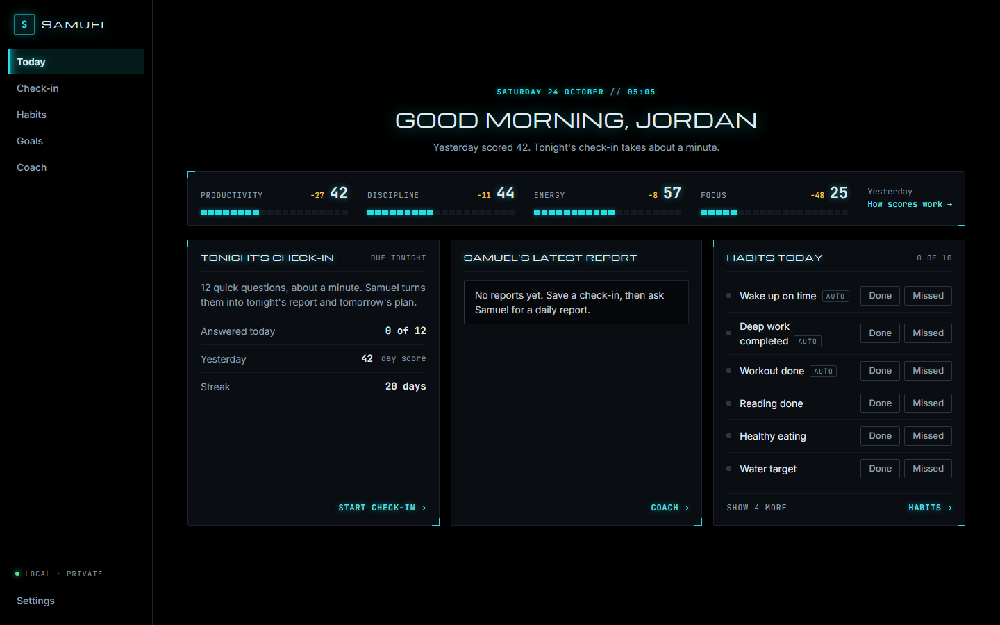
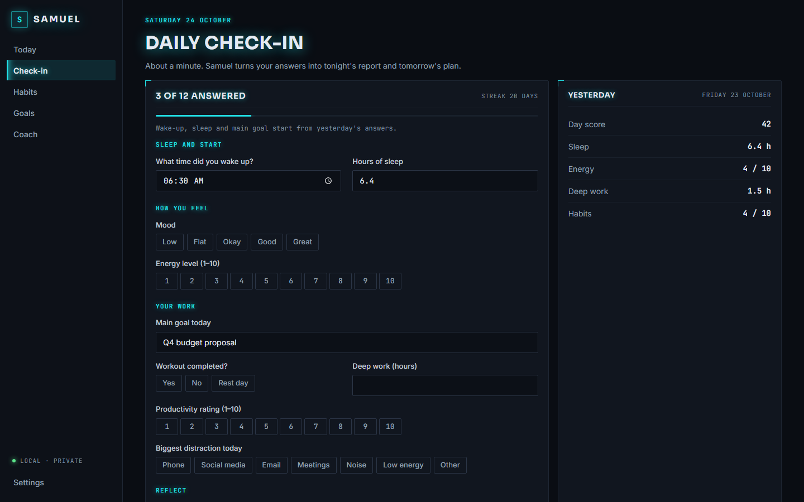
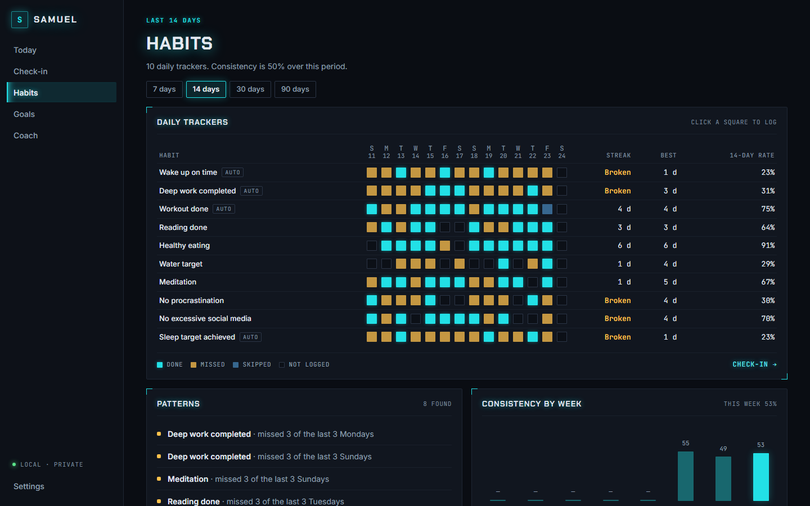
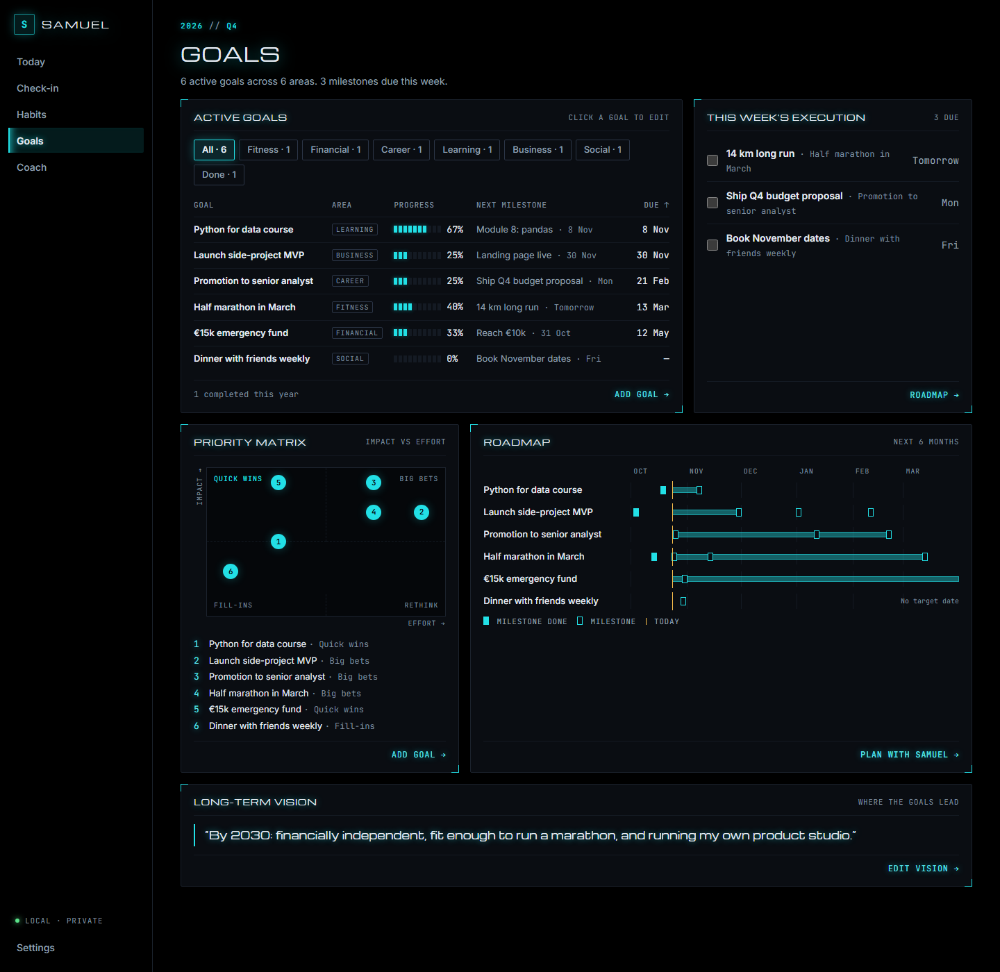

# Building a Life Dashboard

Building a life dashboard using Claude Code.

**Samuel** is a personal performance dashboard and AI coach. It tracks routines, habits, sleep, energy and goals, scores them, and uses Claude Code to write daily reports, weekly reviews and monthly analyses. It runs on your own computer, your data stays in a private local file, and you can reach it from your phone over a private connection. This repo documents the build from design to working app.

## Status

**v0.3.0.** Tell Samuel about your life in a 45-question profile, check in each evening, track 10 daily habits, keep a to-do list with reminders, set goals with milestones, follow today's plan from your routine, watch your sleep, energy, recovery and burnout risk, run weekly and monthly reviews, theme the app from any accent, and have Samuel (Claude Code) write your daily, weekly and monthly reports. It runs on a PC; phone access comes later. See [CHANGELOG.md](CHANGELOG.md) for what's in each release, [docs/PLAN.md](docs/PLAN.md) for the full build plan, [docs/scores.md](docs/scores.md) for how scores work, and [docs/adr/](docs/adr/) for the key decisions.

Screenshots use the made-up demo persona Jordan.









## Run it

You need Python 3.11+, Node 22 and, for Samuel's reports, [Claude Code](https://claude.com/claude-code) logged in on the same computer. The commands below are for Windows PowerShell, run from the folder you cloned the repo into. On macOS or Linux, use `/` in paths and `.venv/bin/` instead of `.venv\Scripts\`.

### Set up (once)

```powershell
cd building-a-life-dashboard\backend
python -m venv .venv
.\.venv\Scripts\python -m pip install -e ".[dev]"
cd ..\frontend
npm install
npm run build
```

### Start Samuel

```powershell
cd building-a-life-dashboard\backend
.\.venv\Scripts\samuel serve
```

Open **http://127.0.0.1:8765**. Leave the PowerShell window open while you use the app, and press **Ctrl+C** to stop the server.

### Open Samuel in its own window

To use Samuel like a desktop app, with no browser tabs, address bar or toolbar:

```powershell
cd building-a-life-dashboardackend
.\.venv\Scripts\samuel app
```

It starts the server if it isn't already running and opens Samuel in a Microsoft Edge app window (Chrome or Chromium if Edge isn't installed). A server it started stops by itself a few minutes after you close the window. You don't need a PowerShell window open. The window keeps its own small browser profile in `~\.samuelpp-window`, separate from your normal browser.

To get a **desktop shortcut** that does this with a double-click and no console window, run `.\.venv\Scripts\samuel app --shortcut` once. You can pin the shortcut to the taskbar.

Samuel uses plain HTTP on `127.0.0.1`. That address never leaves your computer, so there is no network for HTTPS to protect. HTTPS comes with phone access later.

Your data lives in `~\.samuel\samuel.db`, outside this repo. It starts empty, so Home shows dashes until you save your first check-in. Set `SAMUEL_DATA_DIR` to keep it somewhere else.

### Try it with demo data

To explore with the made-up persona Jordan instead of your own data, open a new PowerShell window:

```powershell
cd building-a-life-dashboard\backend
$env:SAMUEL_DATA_DIR = "$env:TEMP\samuel-demo"
.\.venv\Scripts\samuel demo
.\.venv\Scripts\samuel serve
```

The setting only lasts for that window. Close it and open a new one to get back to your real data.

### After pulling new code

```powershell
cd building-a-life-dashboard\backend
.\.venv\Scripts\python -m pip install -e ".[dev]"
cd ..\frontend
npm install
npm run build
```

Then start Samuel again.

### Samuel's reports

Reports need Claude Code installed and logged in on this computer (run `claude` once in a terminal to log in). Use **Generate daily report** on the Coach page, or **Save and write my report** on the check-in. Scores work without Claude Code.

### Backups and moving your data

- **Automatic:** while Samuel runs, it saves a copy of your database once a day to `~\.samuel\backups`, keeping the last 14. It also saves one before every update to the database.
- **Now:** Settings → Your data → **Back up now**, or `.\.venv\Scripts\samuel backup`.
- **Restore a backup:** stop Samuel, then copy the backup file over `~\.samuel\samuel.db`.
- **Export everything** (to move to another PC): `.\.venv\Scripts\samuel export --all --out "$HOME\Documents\samuel-export.json"`. The file holds all your personal data, so keep it private. Samuel refuses to write it inside a git repository.
- **Import** into a fresh, empty Samuel: `.\.venv\Scripts\samuel import "$HOME\Documents\samuel-export.json"`.

### Tips

- **Typing `samuel` without `.\.venv\Scripts\`:** activate the virtualenv with `.\.venv\Scripts\Activate.ps1`. If PowerShell refuses with an "execution policy" error, run `Set-ExecutionPolicy -Scope CurrentUser RemoteSigned` once.
- **"Address already in use":** Samuel is already running in another window. Use that one, or start on another port with `samuel serve --port 8766`.
- **Working on the frontend:** run `npm run dev` in `frontend` while `samuel serve` is running, and open http://localhost:5173 for live reload.

**Contributing:** turn on the privacy check once with `git config core.hooksPath scripts/hooks`. It stops a commit that contains database files, secrets, local paths or personal email addresses. To block your own name too, add it (one word per line) to `.git/info/private-words`, which is never committed.

**Privacy:** the app only listens on this computer and makes no outside requests. The only data that leaves your machine is what Claude Code sends to Anthropic, under your own account, when you ask for a report.

## Design

UI designs live in `design/` (the source of the canvas at https://claude.ai/artifact/1DUdad1m3RYN15j932Dagj):

| File | Screen |
| --- | --- |
| `design/Onboarding.dc.html` | Five-step setup with scores and insights after each section |
| `design/Main.dc.html` | Home: scores, Samuel's brief, today's plan, check-in, needs a reply (optional email), habits, goals |
| `design/Checkin.dc.html` | Daily check-in (12 questions) and yesterday's report |
| `design/Habits.dc.html` | 10 daily trackers, streaks, consistency, failure detection |
| `design/Health.dc.html` | Sleep and energy, recovery, burnout risk, energy curve |
| `design/Goals.dc.html` | Goals by area, priority matrix, roadmap, long-term vision |
| `design/Review.dc.html` | Weekly review |
| `design/Monthly.dc.html` | Monthly evolution |
| `design/Coach.dc.html` | Samuel's reports and Ask Samuel |
| `design/Tasks.dc.html` | Tasks and reminders |
| `design/Palette.dc.html` | Ctrl+K command palette |
| `design/Settings.dc.html` | Appearance: colour wheel, vibe presets, theme and live preview |

Design rules: dark but bright theme with one vivid accent colour; every card ends in an action;
no hero KPI cards, emoji, gradients, glass effects, nested cards, or pure white.

## License

[PolyForm Noncommercial 1.0.0](LICENSE). You may view, use, modify and share this code for any noncommercial purpose. Selling it or using it commercially is not permitted. The software is provided as is, with no warranty or liability.
